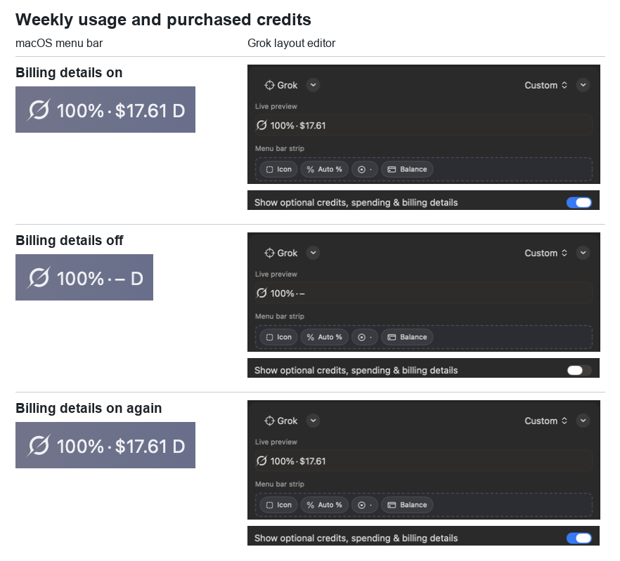
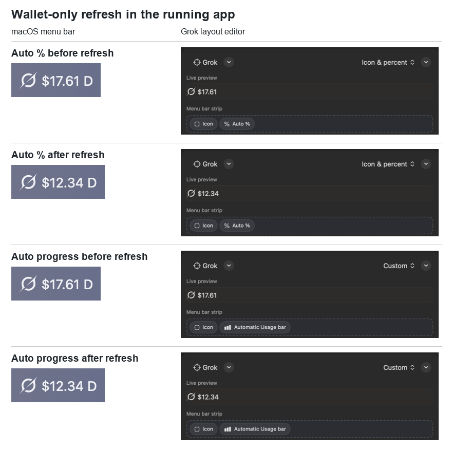

# Grok menu bar runtime captures

These screenshots come from a freshly packaged macOS debug build of CodexBar at `13182501f4df6d248ae91519ec5aa3ebaebc526b`. The left column shows the on-screen Grok status item. The right column shows the open Grok layout editor. The trailing D in the menu bar identifies the debug build.

## Weekly allowance and purchased credits

Grok was the only enabled provider. A local Grok CLI fixture returned a fully used weekly allowance and `prepaidBalance.val` of 1761 cents through the app’s CLI fetch path. In the same running app, changing **Show optional credits, spending & billing details** hid and then restored the wallet. The weekly percentage stayed at 100% throughout.

## Wallet-only refresh

The CLI fixture returned just the wallet in the billing configuration. For each layout, the amount changed from 1761 to 1234 cents while the app and the editor remained open. The one-minute provider refresh updated both surfaces. Each before-and-after pair is from the same process. The status item’s accessibility title also changed from `Grok icon, Usage $17.61, Debug` to `Grok icon, Usage $12.34, Debug`.

